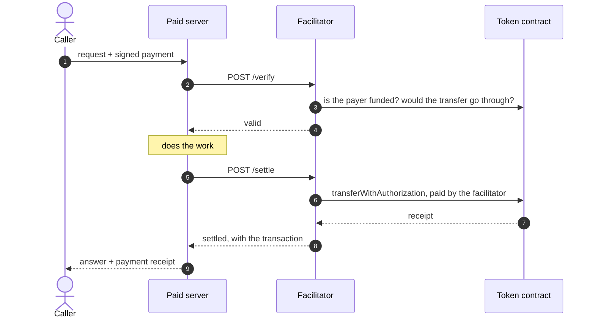

# Agentic x402 Facilitator

[](https://github.com/6022-labs/agentic-x402-facilitator/actions/workflows/go-build.yml)
[](https://github.com/6022-labs/agentic-x402-facilitator/actions/workflows/go-unit-tests.yml)
[](https://github.com/6022-labs/agentic-x402-facilitator/actions/workflows/go-lint.yml)

With [x402](https://x402.org), a server asks to be paid before it answers: the caller signs
a USDC payment and sends it with the request. Someone then has to check that payment and put
it on-chain. That someone is the **facilitator**, and this repository is 6022's.

It checks the signature, the amount and the payer's balance, then sends the payment on-chain
from its own wallet, the **relayer**, which pays the gas. The money goes straight from the payer to the server;
the facilitator never holds it.

It is free, and by default it only works for 6022 agents: the wallet receiving the payment
must be one of the addresses registered on a 6022 agent. Turn that off with
`ACCESS__AGENTS_ONLY=false` if you run your own and want to serve anyone.

It is part of the [6022 agentic ecosystem](https://docs.agentic.6022.io). A
[6022 agent node](https://github.com/6022-labs/agentic-agent-node) uses it by setting
`PAYMENT__RECEIVE__FACILITATORS__<chain_id>__BASE_URL`. Any other x402 server can use it
too, as long as it gets paid on a 6022 agent's wallet.

## Try it locally

You need Docker and an RPC URL for Polygon Amoy (`80002`).

```sh
cp src/x402_facilitator_host/.env.example src/x402_facilitator_host/.env
# set CHAINS__80002__RPC_HTTP_URL in that file
RELAYER_PRIVATE_KEY=0x... docker compose up
```

`RELAYER_PRIVATE_KEY` is the relayer's key, the wallet that pays the gas. Give it some test POL from the
[Amoy faucet](https://faucet.polygon.technology). Compose stores it in a local Vault for you.

Then open:

- the facilitator on http://localhost:5000, with its API docs at `/swagger/index.html`;
- Grafana on http://localhost:3000.

## How a payment goes through



The facilitator exposes four routes:

| Route | What it does |
| --- | --- |
| `POST /verify` | Checks a payment without writing to the chain. |
| `POST /settle` | Checks it again, sends it, and waits for it to be mined. |
| `GET /supported` | Lists the networks it can settle and its wallet address. |
| `GET /health` | Tells you the service is up. |

A payment it refuses still gets a `200`, with `isValid` (or `success`) set to `false` and an
x402 reason such as `insufficient_funds`. That includes a payment to a wallet that is not a
6022 agent.

An HTTP error means something else went wrong:

- `400` or `413`: the body is not JSON, or is too large;
- `502`: the chain, Redis or Vault cannot be reached, or the same payment is already being
  sent. Retry later;
- `500`: an unexpected error.

If a transaction isn't mined within `chains.<id>.receipt_timeout_seconds`, `/settle` answers
`settlement_pending` with its hash.

A retry of a payment already sent is not sent again, and `/verify` refuses it. You get its hash back with
`settlement_pending` until it is confirmed, then `success: false` and
`invalid_transaction_state`. It is never `success: true` a second time, or a replayed payment
would get served: check the hash on-chain instead.

It settles `exact` payments signed with EIP-3009, the method USDC uses. Other payment methods
(Permit2, ERC-7710) and smart-contract wallet signatures are refused.

## Configuration

Settings come from `src/x402_facilitator_host/appsettings.json` or from environment
variables, where double underscores replace the dots: `access.agents_only` is
`ACCESS__AGENTS_ONLY`. [`.env.example`](src/x402_facilitator_host/.env.example) is an
annotated template.

**Chains and tokens**

| Setting | Default | Meaning |
| --- | --- | --- |
| `chains.<id>.rpc_http_url` | — | RPC of a chain to settle on. |
| `chains.<id>.request_timeout_seconds` | `10` | Timeout of each RPC call. |
| `chains.<id>.confirmations` | `1` | Blocks to wait before a payment counts as settled. |
| `chains.<id>.receipt_timeout_seconds` | `120` | How long `/settle` waits before answering `settlement_pending`. |
| `chains.<id>.testnet` | — | Required: `true` on a testnet, `false` on a mainnet. |
| `tokens.<id>.<address>.eip712_name` | — | The token's EIP-712 name, `USDC` for Circle's USDC. |
| `tokens.<id>.<address>.eip712_version` | — | The token's EIP-712 version, `2` for USDC. |

Only the tokens listed here are settled. Write their addresses in lowercase, as environment
variables arrive lowercased: the service refuses to start on a token configured twice.

**Who it serves**

| Setting | Default | Meaning |
| --- | --- | --- |
| `access.agents_only` | `true` | Only settle payments to 6022 agent wallets. |
| `access.cache_ttl_seconds` | `300` | How long an agent lookup is remembered. |

Agents are looked up on every configured chain that has the 6022 contracts (Polygon and
Polygon Amoy today). With `access.agents_only` on, a deployment can't mix testnet and mainnet chains, and refuses to start
if it does: otherwise a cheap testnet agent could get its mainnet payments settled for free.
That is why every chain must say whether it is a testnet.

**Wallet and storage**

| Setting | Default | Meaning |
| --- | --- | --- |
| `vault.address`, `vault.token` | — | The Vault holding the relayer's key. |
| `vault.kv_v1_mount_path` | `secret` | Its KV v1 mount. |
| `relayer.vault_key` | `relayer` | The secret whose `private_key` field is the relayer's key. |
| `redis.host`, `redis.password`, `redis.db` | —, —, `0` | Redis, shared by every instance. Required. |
| `settlement.lock_ttl_seconds` | `600` | How long a payment stays locked if an instance dies while sending it. |

`settlement.lock_ttl_seconds` must be longer than the longest settlement on every chain,
`22 × request_timeout_seconds + receipt_timeout_seconds` (340 seconds with the defaults).
The service refuses to start otherwise.

**Server and telemetry**

| Setting | Default | Meaning |
| --- | --- | --- |
| `host.api_port` | `5000` | HTTP port. |
| `host.body_limit_bytes` | 4 MiB | Largest request body. |
| `host.listen_address` | all interfaces | Address to bind. |
| `telemetry.enabled` | `false` | Export metrics, logs and traces over OTLP. |
| `telemetry.endpoint`, `instance_id`, `environment` | — | Required once telemetry is on. |
| `telemetry.insecure` | `false` | Send over plain gRPC, without TLS. |
| `telemetry.auth_token` or `auth_username` + `auth_password` | — | Collector credentials, one kind only. |

`LOG_LEVEL` (`info` by default) is read straight from the environment.

## Running it in production

**Fund the relayer** on every chain you configure. When it runs dry, every settlement on
that chain fails. The Grafana dashboard shows its balance; set an alert on
`x402_facilitator_relayer_balance`.

**Rate-limit `/settle`.** Anyone who can reach it can make the relayer pay gas for a payment,
even a tiny one. Put the service behind a proxy that limits requests.

**Run as many instances as you like** behind a load balancer. They share everything through
Redis: agent lookups, the lock that stops two instances from sending the same payment, and
the relayer's sent transactions, so they never send two transactions with the same nonce. If the chain
loses a transaction, the next send puts it back.

## Monitoring

With `telemetry.enabled` on, the service sends metrics, logs and traces to Grafana Alloy over
OTLP. `docker compose up` turns it on and starts a full local stack (Alloy, Mimir, Loki,
Tempo, Grafana) with these dashboards:

- **x402 Facilitator**: verifications and settlements by outcome and network, settlements by token; amounts
  verified and settled per token, and settled per agent; gas balance, gas used and gas spent per
  chain; Redis and Vault health.
- **API Requests**, **Blockchain RPC** and **Logs**, shared with the other 6022 services.

Metrics name the payee (`x402_pay_to`) only once a payment to a 6022 agent is verified, and
`other` otherwise. Payers are never named.

Alloy accepts data from anyone by default. On an untrusted network, set
`OTLP_AUTH_HTPASSWD` or `OTLP_AUTH_TOKEN`, and `OTLP_TLS_*`.

## Development

The code follows the same layout as the other 6022 Go services: `src/x402_facilitator` holds
the business logic, and each sibling folder talks to one outside system (`_blockchain`,
`_redis`, `_vault`, `_mvc` for HTTP, `_host` for startup). See [CLAUDE.md](CLAUDE.md) for the
conventions.

```sh
make build            # compile
make test             # unit tests
make integration-test # tests against real anvil, Redis and Vault containers (needs Docker)
make lint             # golangci-lint v2
make mocks            # regenerate the mocks after changing an interface
make swagger          # regenerate the API docs
make abi              # regenerate the contract bindings
```
